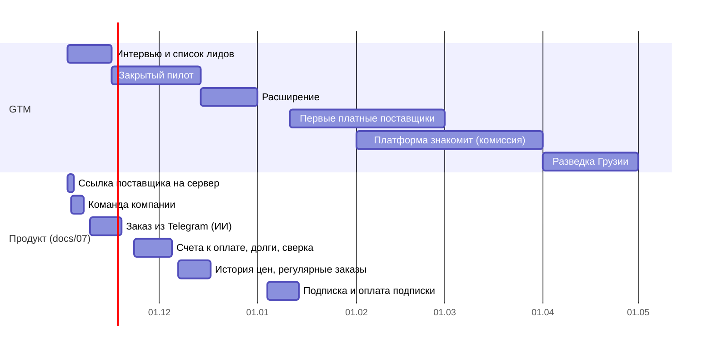

# Easo — выход на рынок (GTM): от первых интервью до платных поставщиков

> v0.1 · 31.10.2026 · опирается на исследование рынка (docs/01) и продуктовый роадмап (docs/07).
> Цифры цен и целей — **гипотезы**, их проверяем на интервью и в пилоте; что проверено, отмечаем в журнале внизу.

## 1. Главное на одной странице

**Кого берём первым:** поставщиков, у которых 20–150 клиентов HoReCa в Ереване, своя доставка и заказы по телефону
и в Telegram. Они приводят заведения сами — через ссылку и QR, без комиссии.

**Что продаём поставщику:** «Заказы из мессенджеров превращаются в заказы Easo. Счёт, накладная и акт выпускаются сами,
видно, кто сколько должен. Клиенты заказывают у вас в любое время, а не звонят в 23:00».

**Что получает заведение:** все поставщики в одном окне, повтор заказа в два касания, торг, документы в одном месте.

**Как зарабатываем:** заказ для заведения бесплатный. Поставщик платит подписку за инструменты и комиссию только
с клиентов, которых привела платформа; отсрочка, логистика и шопер — платные услуги (§4). В пилоте всё бесплатно.

**Где:** Ереван, сначала Кентрон и Арабкир. Категории: сыр и молочка, овощи и зелень, мясо, расходники, кофе.

**Лендинг** — структура и тексты в docs/09-landing.md.

**Главная метрика (North Star):** число заказов через Easo в неделю у пилотных поставщиков. Вспомогательная — **доля**
их заказов, которая идёт через Easo (цель — 30% к 31.12).

## 2. Кому продаём (ICP)

### Поставщик — первый клиент

| Признак | Почему важно |
|---|---|
| 20–150 клиентов HoReCa в Ереване | Меньше — нет боли; больше — обычно уже есть свой портал или агенты |
| Своя доставка, развоз каждый день | Документы на каждый адрес (HO-309-N) — ежедневная боль |
| Заказы приходят по телефону, в Telegram, WhatsApp | Именно это мы заменяем; бот Easo встраивается в привычку клиентов |
| Прайс в Excel или ArmSoft | Загрузка прайса за 15 минут уже работает |
| Решение принимает владелец, до него можно дойти лично | В пилоте нет времени на долгие согласования |

**Лучшие категории для старта:** сыр и молочка, зелень и овощи, мясо (заказ почти каждый день, много мелких позиций),
расходники и упаковка (высокая маржа — выше будущая комиссия), кофе (лояльные клиенты, регулярные заказы).

**Не берём в пилот:** крупных импортёров с отделом продаж и своей системой (долго и им не больно), продавцов без
доставки, поставщиков одного-двух клиентов.

### Заведение

Кафе, кофейни, бары, пекарни, небольшие рестораны в Кентроне и Арабкире: 2–8 поставщиков, закупает владелец или
шеф с телефона, бухгалтер на аутсорсе. Сетям и гостиницам нужны согласования и бюджеты — это после пилота (docs/07).

## 3. Позиционирование и сообщения

**Против чего соревнуемся на самом деле:** не против другого маркетплейса, а против привычки «написал в Telegram,
бухгалтер потом разберётся». Значит, Easo должен быть **проще сообщения** для заведения и **экономить часы** поставщику.

| Кому | Боль | Сообщение |
|---|---|---|
| Владелец поставщика | Заказы в 5 мессенджерах, ошибки, ночные звонки | «Все заказы в одном списке, клиенты заказывают сами 24/7» |
| Бухгалтер поставщика | Счёт и путевой лист до отгрузки на каждый адрес, штраф от 500 000 AMD | «Счёт и накладная готовы в момент подтверждения, номера КГД — в один ввод» |
| Владелец поставщика | Долги клиентов, кто сколько должен | «Видно, кто должен и с какого дня, напоминания уходят сами» (этап «Деньги») |
| Шеф или владелец кафе | Обзвон 5 поставщиков, нет цен перед глазами | «Все поставщики в одной корзине, цены и повтор заказа» |
| Владелец кафе | Цена «как договоримся» | «Предложите свою цену — поставщик ответит быстро» |

**Против ArmSoft B2B:** они связывают тех, у кого обе стороны в ArmSoft. Мы работаем с любым заведением с телефона,
на трёх языках и с торгом, а ArmSoft-выгрузку поставщика читаем сами.

## 4. На чём зарабатываем (гипотеза, проверяем на интервью)

### Принципы

1. **Заказ для заведения бесплатный и без лимитов.** Заведение приводит поставщик; если кафе упрётся в оплату,
   оно вернётся к звонкам, а за ним уйдёт и поставщик. Лимиты ставим на стороне поставщика (число клиентов или заказов).
2. **Торг для покупателя бесплатный.** Договорённая в Easo цена удерживает сделку в Easo. Лимит предложений в день — только
   против спама. Платный — автопилот продавца: он экономит продавцу время.
3. **Поставщик платит за инструменты и за новых клиентов,** которых привела Easo.
4. **Услуги, которые стоят денег нам самим** (логистика, шопер, отсрочка), платные для того, кто ими пользуется.
5. Тяжёлые в работе услуги (логистика, шопер) сначала проверяем вручную на 2–3 заведениях, потом автоматизируем.

### Карта

| Что | Кто платит | Как | Когда |
|---|---|---|---|
| Каталог, корзина, заказ, документы, история | — | бесплатно | всегда |
| Торг для покупателя | — | бесплатно, лимит только от спама | всегда |
| Своих клиентов приводит поставщик | — | 0% навсегда | всегда |
| **«Старт» для поставщика:** каталог, ссылка и QR, заказы, документы | — | бесплатно до 15 клиентов или ~50 заказов в месяц | с января 2027 |
| **«Про» для поставщика:** без лимита клиентов, автопилот торга, команда, долги и лимиты клиентов, отчёты | поставщик | 15 000–25 000 AMD/мес | январь 2027 |
| **Заказ из Telegram с ИИ** (голосовые, фото списка) | поставщик | входит в «Про», сверх лимита — ~50–100 AMD за заказ | январь 2027 |
| **Клиенты, которых привела Easo** | поставщик | 3–5% продукты, 7–10% расходники | февраль–март 2027 |
| **Отсрочка оплаты** (заведение платит через 14–30 дней, поставщик получает сразу) | заведение или поставщик | 1,5–3% за 30 дней, доля с банком | после договора с банком, Q1–Q2 2027 |
| **Логистика** (курьер или машина партнёра для поставщика без доставки) | кто заказывает доставку | тариф партнёра + 10–15% | Q2 2027, сначала вручную |
| **Сборный заказ** (несколько поставщиков — одна доставка и одна приёмка) | заведение | 1 500–3 000 AMD за доставку | после логистики, нужен хаб |
| **Шопер** (закупка на рынке того, чего нет у поставщиков) | заведение | 5–10% от корзины или фикс за выезд | тест вручную в Q1, если подтвердят спрос |
| **Совместная закупка** | — | бесплатно — приводит заведения | когда наберётся объём |
| **Продвижение в каталоге,** рассылка «горящих» остатков | поставщик | за показ или рассылку | от 300 активных заведений |
| **«Сеть» для заведений:** несколько точек, согласование, бюджеты, выгрузка бухгалтеру | сети, гостиницы | 20 000–40 000 AMD/мес | после пилота, 2027 |
| Счета и путевые листы прямо в системе КГД | поставщик | в «Про» или дороже | если появится доступ к API |

**Пилот (до 31.01.2027):** всё бесплатно. **«Основатели»** — первые 10 поставщиков: бесплатно до 31.01.2027, потом
−50% на «Про» на год, прямой канал к разработке. Взамен — еженедельный созвон и честная обратная связь.

### Сколько это может дать (пример на конец 2027, ~390 AMD за $)

| Источник | Пример | В месяц |
|---|---|---|
| Подписки | 50 поставщиков × 20 000 AMD | ~1 млн AMD |
| Комиссия | 50 млн AMD оборота от клиентов Easo × 5% | ~2,5 млн AMD |
| Отсрочка | 30 млн AMD × 2% (наша доля) | ~0,6 млн AMD |
| Логистика, сборный заказ, шопер | 1 500 доставок × ~500 AMD маржи | ~0,75 млн AMD |
| **Итого** | | **~4,8 млн AMD (~$12 тыс.)** |

Одни подписки дают мало — рынок Еревана небольшой. Основные деньги — комиссия с клиентов Easo и финансы (отсрочка).

### Что спросить на интервью о деньгах

- Поставщику: сколько часов в день уходит на приём заказов и документы, кто это делает и сколько стоит этот человек;
  платят ли уже за программы (ArmSoft, 1С, CRM). Цену «Про» ставим ниже одного дня работы менеджера в месяц.
- Заведению: нужна ли отсрочка и сколько готовы за неё платить; закупают ли что-то сами на рынке (спрос на шопера);
  есть ли поставщики без доставки (спрос на логистику).

## 5. Фазы выхода

### Фаза 0 · Интервью и список лидов (2.11 – 15.11)

**Цель:** подтвердить боль и цену, набрать 3 поставщиков в закрытый пилот.

- Список из **40 поставщиков** по ICP: свои знакомые → знакомые знакомых → поставщики, которых называют знакомые
  кафе → справочники (Spyur, B2BMAP) и Instagram. В таблице: категория, число клиентов, как принимают заказы,
  контакт владельца, статус.
- **12–15 интервью с поставщиками** и **10–15 с заведениями** (вопросы — §9). Лучше лично, на складе или в кафе.
- На каждом интервью с поставщиком в конце — живое демо на телефоне: его прайс, загруженный из Excel за 2 минуты.
- Параллельно (продукт): выложить ссылки поставщика на сервер, сделать «Команду компании».

**Переход дальше, когда:** ≥3 поставщика согласились на пилот и прислали прайс; ≥60% опрошенных поставщиков назвали
приём заказов или документы одной из трёх главных болей.

**Если не набрали:** меняем сообщение (что зацепило на интервью?) или категорию, ещё неделя интервью.

### Фаза 1 · Закрытый пилот: 3 поставщика (16.11 – 13.12)

**Цель:** доказать, что заведения поставщика реально заказывают через Easo повторно.

**Подключение «в белых перчатках»** — всё делаем за поставщика:

| День | Что делаем |
|---|---|
| 0 | Встреча с владельцем: загружаем прайс, фото 20 ходовых товаров, условия доставки, текст «О поставщике» |
| 0 | Регистрируем компанию, оператор проверяет в тот же день |
| 1 | Печатаем QR (наклейка на накладную, визитка водителю, табличка на склад) и готовим текст рассылки клиентам на hy/ru |
| 1–3 | Поставщик отправляет ссылку 10–20 самым активным клиентам; мы звоним тем, кто открыл, но не зарегистрировался |
| 3–7 | Первые заказы: сидим рядом с менеджером поставщика, правим мешающее в тот же день |
| 7 | Первый еженедельный созвон: цифры, что неудобно, что дальше |
| 14 | Переводим «заказы из Telegram» на бота Easo (как только готов ИИ-черновик) |

**Еженедельно по каждому поставщику:** приглашено → зарегистрировалось → сделало 1-й заказ → сделало 2+ заказа;
заказов через Easo / всего заказов; что сломалось.

**Переход дальше, когда:** у ≥2 поставщиков ≥10 заведений сделали 2+ заказа; ≥20% их заказов идут через Easo;
поставщик говорит, что продолжит без нас.

**Если нет:** разбираем, где теряем — заведение не регистрируется (сложный вход?), регистрируется, но не заказывает
(проще позвонить?), заказывает один раз (неудобно повторять?). Чиним самое узкое место, а не добавляем фичи.

### Фаза 2 · Расширение и новогодний сезон (14.12 – 31.12)

**Цель:** 5–10 поставщиков, 30+ заведений с заказами, тот же процесс без нашего ежедневного участия.

- Новых поставщиков приводим через пилотных («кто ещё возит вашим клиентам?») и через их клиентов: заведение
  называет своих остальных поставщиков, мы идём к ним с готовым аргументом «ваши клиенты уже здесь».
- Предзаказы к праздникам: «праздничный прайс» с доставкой 27–31.12 — хороший повод для рассылки клиентам.
- Подключение по чек-листу — его может провести поставщик сам, мы только проверяем.
- Сбор отзывов и цифр для кейса: «у [поставщика] 40% заказов через Easo, менеджер освободил N часов в день».

**Готово, когда:** цель года выполнена (5–10 поставщиков, 30+ заведений), есть 2 кейса с цифрами.

### Фаза 3 · Первые платные поставщики (11.01 – 28.02.2027)

**Цель:** проверить, что за Easo платят.

- Включаем тарифы и оплату подписки (переводом по счёту — без эквайринга).
- Пилотные поставщики переходят на «Про» со скидкой «основателей».
- Продажи новым поставщикам: кейсы из фазы 2, демо на их прайсе, первый месяц бесплатно.
- Бухгалтеры на аутсорсе — партнёрский канал: один бухгалтер ведёт десятки «оборотников», им тоже легче с готовыми
  счетами и накладными. Пробуем вознаграждение за приведённого поставщика.

**Готово, когда:** ≥5 платящих поставщиков, отток за месяц — 0–1.

### Фаза 4 · Платформа знакомит (февраль – март 2027)

**Цель:** первые сделки, где Easo привела клиента, — то есть первая комиссия.

- Заведение видит других поставщиков нужных категорий, которые возят в его район (кросс-сейл уже есть в корзине).
- Привлекаем заведения напрямую: Instagram и Telegram-каналы рестораторов, мероприятия, предложение для новых
  заведений («открываетесь? все поставщики в одном месте»).
- Запрос цены (RFQ) — инструмент, который приводит заведение к новым поставщикам.

**Готово, когда:** ≥10% заказов — от клиентов, которых привела платформа; комиссию выставили хотя бы раз в месяц.

### Фаза 5 · Разведка Грузии (апрель 2027)

Только если в Ереване ≥20 платящих поставщиков и модель держится. 10 интервью в Тбилиси, проверка документов
и налогов, грузинский язык в интерфейсе.

## 6. Каналы

| Канал | Кого приводит | Стоимость | Когда |
|---|---|---|---|
| Личные знакомства и рекомендации | поставщики | время | с фазы 0 |
| Визиты на склады и рынки | поставщики | время | с фазы 0 |
| Ссылка и QR поставщика | заведения | печать QR | с фазы 1 — **главный канал** |
| «Кто ещё вам возит?» у пилотных заведений | поставщики | время | с фазы 2 |
| Бухгалтеры на аутсорсе | поставщики | % за приведённого | с фазы 3 |
| Instagram, Telegram-каналы рестораторов | заведения | реклама, контент | с фазы 4 |
| Мероприятия HoReCa | обе стороны | участие | с фазы 4 |

## 7. Метрики

| Метрика | Фаза 1 | Фаза 2 (31.12) | Фаза 3 (28.02) |
|---|---|---|---|
| Активные поставщики (заказ за 7 дней) | 3 | 5–10 | 10–15 |
| Заведения с 1+ заказом | 20 | 30+ | 60+ |
| Заведения с 2+ заказами за 30 дней | 10 | 25 | 50 |
| Заказов через Easo в неделю (**North Star**) | 30 | 100 | 250 |
| Доля заказов пилотных поставщиков через Easo | 20% | 30% | 40% |
| Время от ссылки до первого заказа | < 3 дней | < 2 дней | < 2 дней |
| Платящие поставщики | — | — | ≥5 |

**Воронка заведения:** открыл ссылку → вошёл → зарегистрировал компанию → загрузил выписку → первый заказ → второй
заказ в 30 дней. Все шаги, кроме «открыл ссылку», уже видны в базе; «открыл» и источник перехода — добавить простой
счётчик на `/s/<код>` (продуктовая задача к фазе 1).

**Еженедельный отчёт** (понедельник, 15 минут): таблица по поставщикам, три главные жалобы, решения на неделю.

## 8. Что нужно от продукта для каждой фазы

| Фаза | Обязательно | Желательно |
|---|---|---|
| 0 | Ссылка поставщика на сервере, демо на живом прайсе | Команда компании |
| 1 | Команда компании, счётчик переходов по ссылке, кнопка «что неудобно?» | Заказ из Telegram с ИИ |
| 2 | Заказ из Telegram, долги и напоминания, праздничный прайс | История цен, регулярные заказы |
| 3 | Тарифы, лимит клиентов на «Старт», счёт на подписку | Отчёты поставщику |
| 4 | Каталог других поставщиков для заведения, комиссия в счёте | Запрос цены (RFQ) |

## 9. Вопросы для интервью

**Поставщику** (30 минут, сначала слушаем, демо — в конце):
1. Как к вам приходят заказы? Покажите телефон — сколько чатов с клиентами?
2. Кто принимает заказы и сколько времени это занимает? Что происходит после 20:00?
3. Как с сентября выписываете счёт и путевой лист до отгрузки? Кто это делает, в какой программе?
4. Были ли ошибки в заказах за последний месяц? Что стоила последняя?
5. Как узнаёте, кто вам должен? Сколько сейчас просрочено?
6. Пробовали что-то для заказов (сайт, бот, ArmSoft B2B)? Почему осталось / не осталось?
7. Если бы половина клиентов заказывала сама в приложении — что бы это вам дало?
8. Платите ли за программы сейчас? Сколько стоил бы час вашего менеджера?
9. Кому из ваших клиентов вы бы первым отправили ссылку?

**Заведению:**
1. У скольких поставщиков вы берёте? Как заказываете у каждого?
2. Когда и кто делает заказ? Сколько времени уходит?
3. Что бесит больше всего: цены, сроки, недовес, документы, долги?
4. Торгуетесь ли с поставщиками? Как?
5. Нужна ли отсрочка оплаты? На сколько дней?
6. Если бы все ваши поставщики были в одном приложении — заказывали бы там? Что должно быть, чтобы да?

## 10. Риски и стоп-критерии

| Риск | Признак | Что делаем |
|---|---|---|
| Поставщик подключился, но не зовёт клиентов | < 5 приглашённых за неделю | Готовим рассылку за него, звоним клиентам вместе |
| Заведения регистрируются, но заказывают звонком | 1-й заказ есть, 2-го нет | Заказ из Telegram — заведению не нужно менять привычку |
| Регистрация слишком длинная для кафе | Обрыв на выписке из реестра | Дать сделать первый заказ до загрузки выписки (решение по доступу, docs/05) |
| Поставщики не готовы платить | На интервью «только бесплатно» | Сдвигаем доход на комиссию и на отсрочку через банк |
| Один основатель не успевает и продавать, и строить | Пилот без созвонов, фичи стоят | Режем этап 3 продукта, не пилот (docs/07) |

**Стоп-критерий модели:** если к 31.12 ни у одного поставщика нет ≥20% заказов через Easo, пересматриваем ставку
«поставщик приводит клиентов» — вероятная альтернатива: Easo как программа для поставщика (SaaS по модели Choco),
без маркетплейса.

## 11. Решения за владельцем

1. Юрлицо и договор: оферта для пилота уже на экране; нужен ли отдельный договор с «основателями».
2. Цены «Про» после интервью — утвердить к 15.12.
3. Кто ходит на встречи: только вы или ещё один человек на продажи в фазах 2–3.
4. Бюджет на фазу 1: печать QR и табличек (~50 000 AMD), транспорт.
5. Бренд для заведений: «Easo» на армянском и русском — как произносится и запоминается; проверить на интервью.

## Журнал проверки гипотез

| Дата | Гипотеза | Что узнали | Решение |
|---|---|---|---|
| | | | |
